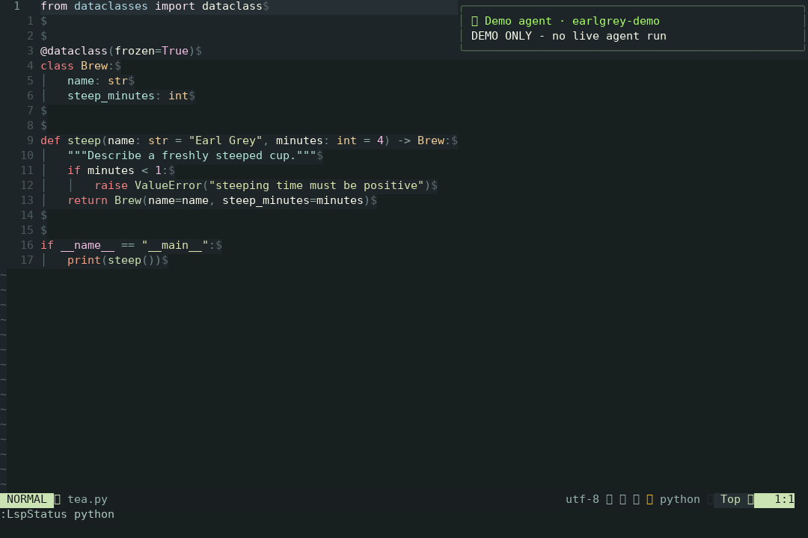
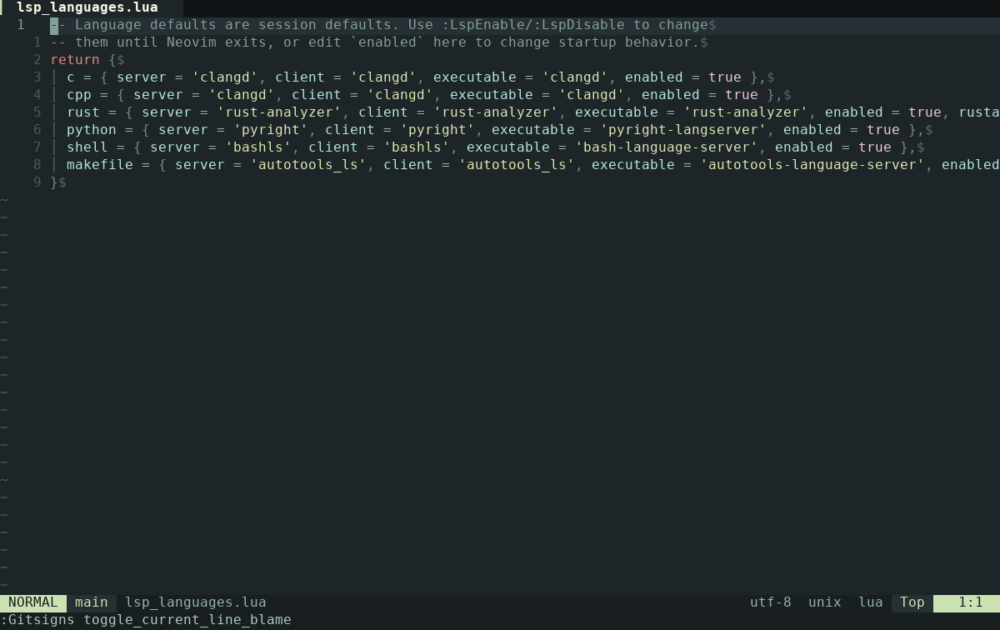

<div align="center">

# earlgrey.nvim

[English](docs/guide.md#english) · [日本語](docs/guide.md#japanese)

**얼그레이 네오빔 · A warm cup. A focused editor.**


차 한 잔의 여유로, 코드에 몰입하는 Neovim.


[](LICENSE)

</div>

## 소개

별도 터미널의 AI 에이전트 알림과 언어별 LSP 전환을 제공하는 Neovim 설정입니다. FzfLua 검색, Blink 자동 완성, Markdown 렌더링을 포함하며 lazy.nvim으로 관리합니다.



<details>
<summary>검색 → LSP 전환 → 에이전트 알림 데모</summary>



Linux에서 실제 Neovim을 녹화했습니다. 에이전트 알림은 시연용 이벤트이며, 캡처 방법은 [미디어 안내](docs/assets/README.md)에 있습니다.

</details>

## 설치

Neovim **0.12 이상**이 필요합니다. 설치기는 Git, 컴파일 도구, `tree-sitter` CLI, `fd`, `rg`, `fzf` 등 필요한 도구와 설정을 설치합니다. 인터넷 연결이 필요하며 Linux에서 시스템 패키지를 설치할 때는 `sudo` 권한이 필요합니다.

저장소를 받은 뒤 운영체제에 맞는 설치기를 실행하세요.

```sh
git clone https://github.com/gamjagoon/earlgrey.nvim.git
cd earlgrey.nvim

# Linux
bash script/install-linux.sh

# macOS
bash script/install-macos.sh
```

Windows 10/11에서는 PowerShell 5.1 이상과 WinGet이 필요합니다.

```powershell
powershell -NoProfile -ExecutionPolicy Bypass -File .\script\install-windows.ps1 -Mode All
```

작업은 Unix의 `--mode`, Windows의 `-Mode`로 선택합니다: `all` · `tools` · `config` · `check`. [모드 안내](docs/guide.md#installer-modes)

기존 Neovim 설정은 설치 전에 날짜가 붙은 백업으로 보존합니다. Linux/macOS는 설정을 연결하고, Windows는 복사합니다.

## 설치 후 시작

`nvim` 실행 → `Space ff`로 파일 찾기 → `Space fg`로 내용 검색.
`:LspStatus`로 언어 서버 상태를, `:AgentNotifications test`로 팝업을 확인합니다.
실제 에이전트 연결은 [hook 설치 안내](docs/agent-notifications.md)를 따르세요.
Linux 실행을 확인했으며, macOS/Windows 설치기는 모의 테스트까지 검증했습니다.
에이전트 hook 설치는 Linux·WSL·macOS를 지원하며 네이티브 Windows는 지원하지 않습니다.

## 자주 쓰는 단축키

Leader 키는 `Space`입니다.

| 단축키 | 동작 |
| --- | --- |
| `Ctrl-h/j/k/l` | 창 이동 |
| `Shift-h/l` | 이전·다음 버퍼 |
| `Space 1` … `Space 9` | 번호로 버퍼 선택 |
| `Space e` | 파일 트리 열기·닫기 |
| `Space ff` | 파일 찾기 |
| `Space fg` | 파일 내용 검색 |
| `Space /` | 현재 버퍼 검색 |

## 자세한 안내

- [전체 설정·설치·단축키 안내](docs/guide.md) (한국어 · English · 日本語)
- [Windows 설치와 도구 설정](docs/windows-setup.md)
- [LSP 설정](docs/lsp.md)
- [에이전트 완료 알림](docs/agent-notifications.md)
- [이미지 미리보기 · Image preview · 画像プレビュー](docs/images.md)
- [터미널 도구](docs/terminal-tools.md)
- [소개 글과 홍보 자료](docs/promotion.md)

English and Japanese readers: see the [English guide](docs/guide.md#english) and [日本語ガイド](docs/guide.md#japanese).

## 첫 사용 피드백

처음 설치해 볼 분 3~5명의 의견을 받고 있습니다. 설치가 막힌 단계나 헷갈리는
단축키를 [첫 사용 피드백](https://github.com/gamjagoon/earlgrey.nvim/issues/new?template=first-run.yml)으로 알려주세요.
OS, Neovim 버전, 실행한 설치 모드와 결과를 남겨주시면 재현에 도움이 됩니다.

## 라이선스

이 저장소의 코드는 [MIT 라이선스](LICENSE)로 배포합니다.
외부 플러그인과 도구에는 각각의 라이선스가 적용됩니다.
